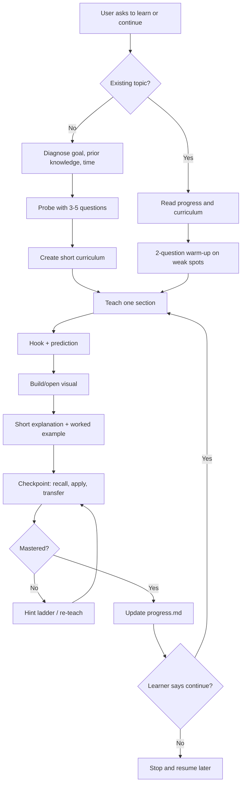

# opencode-learn

Turn [OpenCode](https://opencode.ai) into an interactive tutor that teaches one small section at a time, quizzes for understanding, builds interactive visuals, fact-checks uncertain claims, and keeps lightweight progress in your workspace.

## Overview

`opencode-learn` is a small OpenCode learning system: a `teach` skill, a `researcher` fact-checking subagent, and a simple workspace convention for curriculum, progress, and visuals.

It is for people who want AI-assisted learning that feels more like guided tutoring than a one-shot explanation. Instead of dumping a full topic, it diagnoses your level, teaches in small steps, asks you to retrieve and apply ideas, and keeps enough state to resume later.

## Why use it

A normal chat can explain a topic, but it often optimizes for answering, not learning. This project adds structure around the learning loop:

- **Diagnosis before teaching** - checks your goal and starting level.
- **Small steps** - one section at a time, with a checkpoint before moving on.
- **Retrieval practice** - recall, apply, and transfer questions.
- **Visual explanations** - self-contained HTML demos when motion or state changes help.
- **Fact checking** - a separate researcher subagent for claims that should be verified.
- **Persistent progress** - lightweight files track where you are and what needs review.

## Features

| Feature | Implemented | Notes |
|---|---:|---|
| `teach` skill | Yes | Main tutoring workflow in `.opencode/skill/teach/SKILL.md`. |
| `researcher` subagent | Yes | Fact-checks claims with web sources; returns verdicts with URLs. |
| Diagnosis and curriculum | Yes | Probes starting level and creates a short curriculum outline. |
| Section checkpoints | Yes | 3 questions per section: recall, apply, transfer. |
| Hint ladder / misconception repair | Yes | Gives hints before full answers; re-teaches after missed checkpoints. |
| Progress tracking | Yes | Updates `notes/<topic>/progress.md` each session. |
| Interactive HTML visuals | Yes | Creates self-contained demos in `viz/<topic>/`. |
| SVG figure checks | Partial / guidance | Skill includes SVG quality checks, but no automated SVG renderer/linter is bundled. |
| Obsidian-friendly notes | Yes, optional | Notes are plain Markdown files in `notes/`; no Obsidian plugin required. |
| Automatic grading engine / SG system | No | No separate SG/subgoal engine or automated assessment framework is implemented. |

## How it works



## Learning methodology

The `teach` skill is intentionally opinionated:

- **Retrieval beats re-reading** - learners answer before and after explanations.
- **One small step at a time** - the agent stops at checkpoints.
- **Concrete before abstract** - examples come before general rules.
- **Predict, then reveal** - learners commit to an expectation before seeing results.
- **Diagnose misconceptions** - wrong answers are used to repair mental models.
- **Mastery gates progress** - sections are not advanced until the checkpoint is passed.
- **Honest certainty** - uncertain facts should be verified or labeled uncertain.

## Repository structure

```text
.
├── .opencode/
│   ├── agent/
│   │   └── researcher.md        # Fact-checking subagent
│   └── skill/
│       └── teach/
│           └── SKILL.md         # Main teaching workflow
├── docs/
│   ├── ARCHITECTURE.md
│   ├── EXAMPLES.md
│   ├── FAQ.md
│   ├── INSTALLATION.md
│   └── USAGE.md
├── AGENTS.md                    # Workspace instruction for OpenCode
├── CONTRIBUTING.md
├── LICENSE
└── README.md
```

Runtime learning data is created in your workspace and intentionally git-ignored:

```text
notes/<topic>/curriculum.md
notes/<topic>/progress.md
viz/<topic>/<nn-section-name>.html
```

## Installation

### Prerequisites

- [OpenCode](https://opencode.ai) installed and configured.
- A model/provider configured in OpenCode.
- Optional but recommended: web search/fetch capability for the `researcher` subagent.
- Optional: [Obsidian](https://obsidian.md) if you want to browse `notes/` as a vault.

### Install

Copy this repository's `.opencode/` directory and `AGENTS.md` into the workspace where you want to learn.

Windows (PowerShell):

```powershell
git clone https://github.com/hichemuuus/opencode-learn.git
$dest = "D:\Learning\learn"   # change this
New-Item -ItemType Directory -Force -Path $dest | Out-Null
Copy-Item .\opencode-learn\.opencode $dest\.opencode -Recurse -Force
Copy-Item .\opencode-learn\AGENTS.md $dest\AGENTS.md -Force
Set-Location $dest
opencode
```

macOS / Linux:

```bash
git clone https://github.com/hichemuuus/opencode-learn.git
dest="$HOME/learn"   # change this
mkdir -p "$dest"
cp -r ./opencode-learn/.opencode "$dest/"
cp ./opencode-learn/AGENTS.md "$dest/"
cd "$dest"
opencode
```

For full setup details, see [docs/INSTALLATION.md](docs/INSTALLATION.md).

## Quick start

1. Open your learning workspace in OpenCode.
2. Start a topic:

```text
Use the teach skill. I want to learn TCP/IP from first principles.
```

3. Answer the diagnosis questions.
4. Work through one section at a time; answer checkpoint questions in your own words.
5. Resume later with:

```text
Read progress.md and continue TCP/IP.
```

## Example

A realistic first request:

```text
Use the teach skill. I want to learn Git branching well enough to use it confidently at work. I know basic commit/push/pull.
```

The system should:

1. Ask your goal, prior knowledge, and session length.
2. Probe your current understanding with a few short questions.
3. Create `notes/git-branching/curriculum.md`.
4. Teach section 1, build a visual in `viz/git-branching/`, and ask a 3-question checkpoint.
5. Update `notes/git-branching/progress.md` before moving on.

## Configuration

| Location | What to change | Purpose |
|---|---|---|
| `AGENTS.md` | Workspace instruction text | Tells OpenCode when to use the teach skill and where progress lives. |
| `.opencode/skill/teach/SKILL.md` | Teaching rules, pacing, visual rules, progress format | Customize the learning workflow. |
| `.opencode/agent/researcher.md` | `model:` (optional), research behavior | Use a stronger verifier model or adjust fact-check behavior. |
| `.gitignore` | Ignored paths | Keep personal notes/visuals or local secrets out of Git. |

## Obsidian integration

Obsidian is optional. The learning system writes plain Markdown files under `notes/`, so any editor works.

If you use Obsidian:

- Open the workspace folder (or your notes folder) as a vault/folder in Obsidian.
- Keep the vault path separate from this Git repository unless you intentionally want notes versioned.
- The teach skill creates `notes/<topic>/...`; it does not install or require Obsidian plugins.

See [docs/INSTALLATION.md](docs/INSTALLATION.md#obsidian-setup-optional).

## Limitations

- **Model-dependent quality** - explanations, quizzes, and diagnosis quality depend on the model you run.
- **Not a formal course platform** - there is no LMS, gradebook, spaced-repetition scheduler, or user account system.
- **No enforced SG/subgoal engine** - the curriculum is a lightweight outline; it does not implement a separate formal SG framework.
- **Verification depends on tools** - the researcher subagent is only as good as its available web access and model.
- **Visuals are generated artifacts** - HTML demos are created by the agent; review them before trusting complex technical visualizations.
- **Local workspace state** - progress lives in files; if you delete `notes/`, resume context is lost.

## Contributing

See [CONTRIBUTING.md](CONTRIBUTING.md). Contributions that improve clarity, accuracy, portability, or teaching quality are welcome.

## License

This project is licensed under the MIT License. See [LICENSE](LICENSE).
