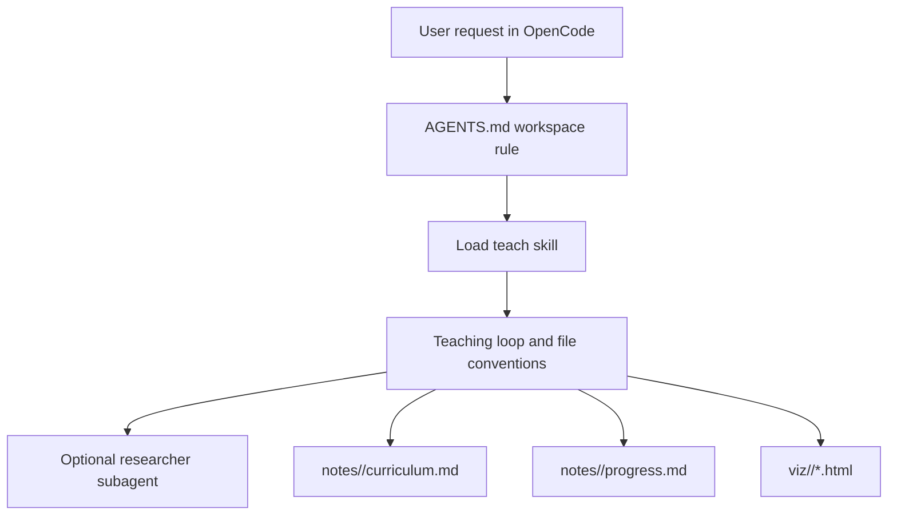
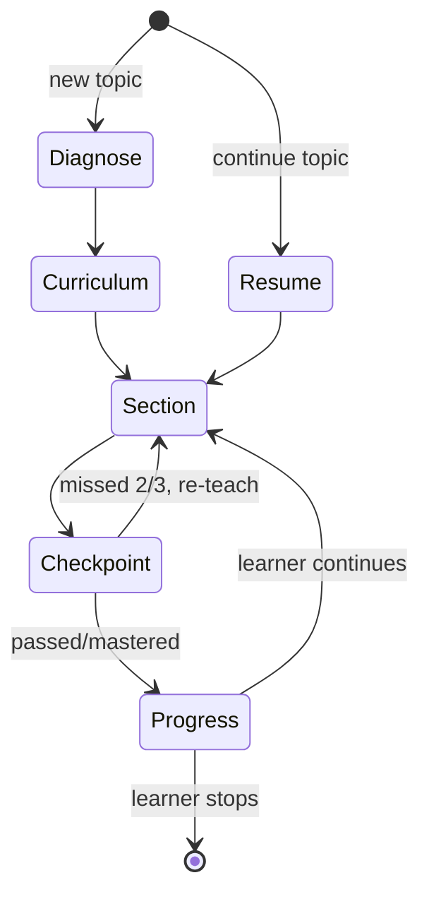

# Architecture

This document describes how `opencode-learn` is structured based on the files in this repository.

## Components

| Component | Path | Responsibility |
|---|---|---|
| Workspace instruction | `AGENTS.md` | Tells OpenCode this workspace is for learning and to use the `teach` skill for learning/continue requests. |
| Teach skill | `.opencode/skill/teach/SKILL.md` | Defines the tutoring workflow: diagnosis, curriculum, section loop, checkpoints, visuals, verification, progress format. |
| Researcher subagent | `.opencode/agent/researcher.md` | Verifies factual claims using web sources and returns structured verdicts. |
| Documentation | `docs/*.md`, `README.md` | User-facing installation, usage, architecture, examples, FAQ, contributing. |
| License | `LICENSE` | MIT license text. |

## Instruction hierarchy

- **`AGENTS.md`** is the workspace-level trigger. It routes learning/continue requests to `teach`.
- **`SKILL.md`** contains the detailed teaching method. It is the main behavioral contract.
- **`researcher.md`** is a narrow subagent contract. It cannot edit files and should return verdicts with sources.

## Teach workflow

The teach skill implements this lifecycle:

1. **Session start** - detect whether topic is new or continuing.
2. **Diagnose** - ask goal, prior knowledge, session length; probe with 3-5 questions.
3. **Curriculum** - create `notes/<topic>/curriculum.md` with 3-6 phases.
4. **Section loop** - hook, visual, explanation, worked example, checkpoint, grade, progress update.
5. **Phase end** - mastery check, mini project guidance, mixed review, curriculum adjustment.

## File responsibilities

### `AGENTS.md`

- Applies to the workspace.
- Routes learning requests to `teach`.
- Specifies progress/curriculum path conventions.
- Mentions fact verification through `researcher`.

### `.opencode/skill/teach/SKILL.md`

- Defines learning principles.
- Defines runtime file layout (`notes/<topic>/`, `viz/<topic>/`).
- Defines session start behavior for new vs continuing topics.
- Defines checkpoint structure: recall, apply, transfer.
- Defines hint ladder and mastery gate.
- Defines visual requirements and SVG checks.
- Defines verification rules.
- Defines progress file format.

### `.opencode/agent/researcher.md`

- `mode: subagent`.
- Disables `write`, `edit`, `bash`.
- Requires web search/fetch behavior in prompt.
- Returns per-claim verdict: `SUPPORTED | CONTRADICTED | PARTLY CORRECT | UNVERIFIED`.

## Learning lifecycle and persistence

Persistent state is intentionally small:

- `curriculum.md` - short plan.
- `progress.md` - covered sections, weak spots, next step.
- `viz/<topic>/*.html` - generated visual artifacts.

There is no database, no hidden state store, and no external sync service in this repository.

## Obsidian integration

Obsidian is an optional viewer/editor for Markdown notes. The system does not depend on Obsidian APIs or plugins. Any editor can read/write the same files.

Design implication: paths should be configured consistently. If you change note paths, update `AGENTS.md` and `SKILL.md` together.

## Verification design

The skill separates teaching from fact-checking:

- The main teaching agent handles pedagogy and interaction.
- The `researcher` subagent handles source-backed claim checking.
- Code/computable claims should be run when possible.
- Uncertain claims without reliable sources should be labeled uncertain.

This is a design guardrail, not a formal proof system. Model/tool failures are still possible.

## Design decisions

- **File-based state** - simple, inspectable, portable, easy to resume.
- **One section at a time** - reduces cognitive overload and enforces checkpoints.
- **Mandatory visuals** - encourages concrete understanding; may be heavier for abstract topics.
- **Minimal notes** - avoids generating large passive summaries; progress file is the source of truth.
- **No bundled runtime dependencies** - the core system is instructions and Markdown, not an app server.

## Extension points

Safe places to extend:

- `SKILL.md` - pacing, quiz style, visual rules, progress format.
- `researcher.md` - model selection, evidence standards, output format.
- `AGENTS.md` - workspace trigger and path conventions.
- `docs/` - installation and usage guidance for your fork.

When extending, preserve the core contract: diagnose, teach in small steps, checkpoint before advancing, update progress, and be honest about uncertainty.
